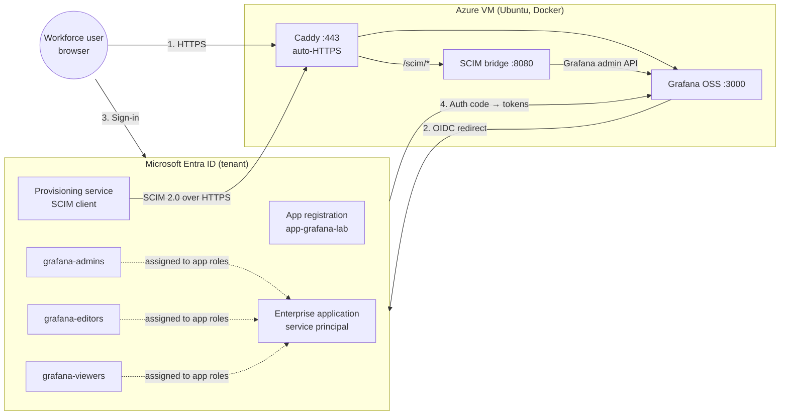
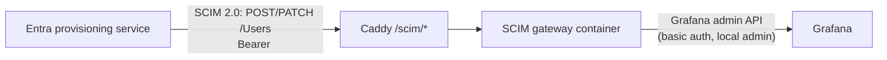

# 00 - Architecture

This document is the reference model for the whole lab: components, networking, identities, the Entra object model, token flow, provisioning flow, and the permissions required to build each piece.

## 1. Component overview



Two planes to keep separate mentally:

- **Runtime (authentication) plane** - a user opens Grafana, is redirected to Entra, authenticates, and returns with tokens. Grafana creates/updates the session and derives the org role from the token. This happens at every login.
- **Provisioning (management) plane** - the Entra provisioning service pushes account lifecycle events (create, update, disable) to the app's SCIM endpoint on a cycle Microsoft documents as approximately 40 minutes ([Microsoft Learn](https://learn.microsoft.com/entra/identity/app-provisioning/use-scim-to-provision-users-and-groups)). This happens whether or not the user ever logs in, and is what guarantees *deprovisioning*. SSO alone only stops future logins; it does not remove the account.

## 2. Azure infrastructure and networking

| Resource | Value | Notes |
|---|---|---|
| Resource group | `rg-grafana-iam-lab` | Single RG; delete it to tear down everything |
| VM | `vm-grafana-lab`, Ubuntu Server 22.04 LTS (x64 Gen2), `Standard_B2als_v2` | 2 vCPU / 4 GiB burstable; sufficient for Grafana + Caddy + gateway. |
| Public IP | Standard SKU, static, DNS label | FQDN: `<DNS_LABEL>.<REGION>.cloudapp.azure.com` |
| NSG | Inbound: 22 (restricted to `<Admin_IP>`), 80, 443 (from "Any") | 80 stays open, required for ACME HTTP-01 challenge |
| OS | Docker Engine + Compose plugin | Installed post-provision |

Network flows (all TCP):

| # | Source | Destination | Port | Purpose |
|---|---|---|---|---|
| 1 | User browser | VM public IP | 443 | Grafana UI via Caddy |
| 2 | User browser | `login.microsoftonline.com` | 443 | Interactive sign-in (authorize endpoint) |
| 3 | Grafana (outbound) | `login.microsoftonline.com` | 443 | Code-for-token exchange, key discovery (JWKS) |
| 4 | Let's Encrypt | VM public IP | 80/443 | ACME challenge for certificate issuance/renewal |
| 5 | Entra provisioning service | VM public IP | 443 (`/scim/*`) | SCIM create/update/disable (Phase 3) |
| 6 | Admin workstation | VM public IP | 22 | SSH, restricted to `<Admin_IP>` |

Container-internal traffic (`caddy → grafana:3000`, `scim-bridge → grafana:3000`) stays on the Docker bridge network; Grafana's port 3000 is never exposed on the host. TLS terminates at Caddy.

Why a public endpoint at all: both browser-based OIDC redirects and the Entra provisioning service originate outside the VM. Provisioning in particular has no agent option for SCIM - Entra's cloud service must reach the endpoint over public HTTPS with a valid certificate.

## 3. Identity model

| Object | Name | Purpose |
|---|---|---|
| Admin account | (existing tenant admin) | Builds the lab. In a real tenant this would be role-scoped, not Global Admin - see §8 |
| Test user | `amanda.admin@<TENANT_DOMAIN>` | Grafana admin persona (via `grafana-admins`) |
| Test user | `edvard.editor@<TENANT_DOMAIN>` | Editor persona |
| Test user | `victoria.viewer@<TENANT_DOMAIN>` | Viewer persona; also the deprovisioning test subject |
| Security group | `grafana-admins` | → app role `Admin` |
| Security group | `grafana-editors` | → app role `Editor` |
| Security group | `grafana-viewers` | → app role `Viewer` |

Design notes:

- **Groups are the unit of assignment**, never individual users. Users get Grafana access exclusively through group membership; membership drives both the app role (SSO) and the provisioning scope (SCIM). One control point for the whole lifecycle.
- Users must be **direct** members. Entra does not expand nested groups when resolving app role assignments, and Microsoft lists this as unsupported "for both access and provisioning", so it constrains SCIM scope here as well as the role mapping ([Entra service limits](https://learn.microsoft.com/entra/identity/users/directory-service-limits-restrictions)). A platform limitation rather than a design choice, and a classic lab trap.
- The local Grafana `admin` account remains the documented break-glass path in case SSO misconfiguration locks everyone out.

## 4. Entra object model: app registration vs. enterprise application

The single most-tested distinction in this space:

| | App registration (`application` object) | Enterprise application (`servicePrincipal` object) |
|---|---|---|
| What it is | The application's *definition* (blueprint) | The application's *instance* in a tenant (the identity that actually signs in / gets assigned) |
| Lives in | Home tenant only | Every tenant that uses the app |
| Holds | Redirect URIs, client secrets, **app role definitions**, API permissions, token configuration | **User/group assignments to app roles**, SSO settings, **provisioning configuration**, ownership |
| This lab | `app-grafana-lab` - defines the OIDC client and the `Viewer`/`Editor`/`Admin` app roles | Auto-created when the app is registered; where groups are assigned to roles. (Provisioning runs on a second, non-gallery service principal `app-grafana-scim` - see docs/03) |

Registering the app creates both objects. Everything on the "assignment and provisioning" side happens on a service principal; everything on the "protocol and token" side happens on the registration.

### App registration configuration

| Setting | Value | Why |
|---|---|---|
| Supported account types | Single tenant | Workforce app; no external accounts |
| Platform / Redirect URI | Web: `https://<GRAFANA_FQDN>/login/azuread` | Grafana's fixed callback path for the azuread provider |
| Client credential | Client secret (`<CLIENT_SECRET>`, expiry ≤ 6 months) | Grafana is a confidential client and it can hold a secret server-side. Certificate or federated credential would be the production-grade upgrade |
| App roles | `Viewer`, `Editor`, `Admin` (+ optional `GrafanaAdmin`), member types: Users/Groups | The `value` field must match Grafana role names exactly; Grafana maps the token's `roles` claim to its org role. `GrafanaAdmin` additionally grants *server* admin, which requires `allow_assign_grafana_admin = true` and defaults to `false` ([Grafana docs](https://grafana.com/docs/grafana/latest/setup-grafana/configure-access/configure-authentication/entraid/)) |
| API permissions | Default `openid`, `profile`, `email` (delegated) | No Graph permissions needed. Role data comes from app roles, not group lookups |

### Enterprise application configuration

| Setting | Value | Why |
|---|---|---|
| Assignment required | **Yes** | Unassigned users get `AADSTS50105` at the IdP instead of an unauthorized shell account in the app ([Microsoft Learn](https://learn.microsoft.com/troubleshoot/entra/entra-id/app-integration/error-code-aadsts50105-user-not-assigned-role)). The deny-by-default control of the lab |
| Users and groups | The three `grafana-*` groups, each mapped to its app role | Group-based assignment; P1+ feature |
| Visible to users | Yes (My Apps) | Lets test users launch from myapps.microsoft.com |

## 5. Token flow and claims (Phase 2)

Authorization code flow with PKCE (`use_pkce = true`), Grafana as a confidential client:

```mermaid
sequenceDiagram
    participant B as Browser (amanda.admin)
    participant G as Grafana
    participant E as Entra ID

    B->>G: GET https://<GRAFANA_FQDN>/login/azuread
    G->>B: 302 → /authorize (client_id, redirect_uri, scope=openid profile email,<br/>state, code_challenge)
    B->>E: /authorize - sign-in, consent
    E->>B: 302 → /login/azuread?code=...&state=...
    B->>G: callback with authorization code
    G->>E: POST /token (code, client_secret, code_verifier)
    E->>G: ID token + access token (JWTs)
    G->>G: validate signature (JWKS), issuer, audience;<br/>read claims → create/update user, set org role from `roles`
    G->>B: Grafana session cookie
```

Claims Grafana consumes (ID token, `v2.0` issuer):

```jsonc
{
  "aud": "<CLIENT_ID>",                     // must match the app registration
  "iss": "https://login.microsoftonline.com/<TENANT_ID>/v2.0",
  "tid": "<TENANT_ID>",                     // checked against allowed_organizations
  "oid": "<user object id>",                // stable user identifier
  "name": "Amanda Admin",
  "preferred_username": "amanda.admin@<TENANT_DOMAIN>",
  "email": "amanda.admin@<TENANT_DOMAIN>",
  "roles": ["Admin"]                        // ← app role values for this user's assignments;
                                            //    Grafana maps this to its org role
}
```

Points worth internalizing:

- **App roles carry no permissions.** On the Entra side the three roles are just labeled strings; Entra only decides which string enters each user's `roles` claim. What `Admin`, `Editor`, and `Viewer` are *allowed to do* is defined and enforced entirely by Grafana's built-in org-role RBAC. Nothing per-role was configured in this lab on either side. This is the standard division of labor in SSO: **the IdP handles authentication and role assignment; the application handles permission enforcement.** (Contrast with a custom-built API, where the developer defines in code what each role value means.)
- The `roles` claim appears **only if** the user (directly or via group) is assigned to at least one app role on the service principal ([Microsoft Learn](https://learn.microsoft.com/entra/identity-platform/howto-add-app-roles-in-apps)). No assignment → no claim → with `role_attribute_strict = true`, login denied. Worth noting that Grafana's default for that setting is `false` ([Grafana docs](https://grafana.com/docs/grafana/latest/setup-grafana/configure-access/configure-authentication/entraid/)), so this is a deliberate departure from the default that makes authorization failures loud instead of silently defaulting everyone to Viewer.
- **App roles vs. groups claim:** the alternative design emits group object IDs (`groups` claim) and maps them in the app. That breaks past 200 groups for JWT, and 150 for SAML, where the claim is replaced by an overage indication and the app must call Microsoft Graph instead ([Microsoft Learn](https://learn.microsoft.com/security/zero-trust/develop/configure-tokens-group-claims-app-roles#group-overages)). It also leaks directory structure to the app and couples app config to tenant-specific GUIDs. App roles put a stable, app-defined vocabulary in the token. Same reasoning as from a previous custom API lab, now applied from the admin side.
- Grafana re-evaluates the role at **every login** (`skip_org_role_sync = false`): demote a user by moving groups and the change lands on their next sign-in, but not before. The mid-session and never-logs-in-again cases are what Phase 3 (SCIM) covers.

## 6. Provisioning architecture (Phase 3)



- The Entra provisioning service is agentless: configured on the enterprise application with a **Tenant URL** (`https://<GRAFANA_FQDN>/scim`) and a **secret token**, it runs an initial sync then incremental cycles, documented at approximately every 40 minutes and not configurable ([Microsoft Learn](https://learn.microsoft.com/entra/identity/app-provisioning/use-scim-to-provision-users-and-groups)). Microsoft also publishes the IP ranges the provisioning service operates from, which is the hook for restricting the endpoint in production ([IP ranges](https://learn.microsoft.com/entra/identity/app-provisioning/use-scim-to-provision-users-and-groups#ip-ranges)).
- **Scope = assigned users and groups**: the same three groups drive provisioning, so assignment, role, and account lifecycle all hang off one membership operation.
- Lifecycle mapping: user added to group → SCIM `POST /Users` (account created before first login - no JIT dependency); attribute change → `PATCH`; user removed from group / disabled / deleted → `PATCH active=false` (soft delete), which the gateway maps to disabling the Grafana account.
- The gateway exists because self-hosted Grafana exposes SCIM natively only under an Enterprise license. Entra's configuration, attribute mappings, scoping and monitoring are identical either way - the Entra-side skills transfer 1:1.
- The gateway holds a Grafana admin credential; it listens only on the Docker network, and the SCIM endpoint requires the bearer token. Both secrets live in `.env`. That bearer token is consequently the only thing between the public internet and account administration, which is the reason the bridge implements no destructive operation at all ([ADR 0001](adr/0001-soft-delete-over-hard-delete.md)) and is discussed further in the [risk note](risk-and-limitations.md#the-bearer-token-is-the-only-thing-in-front-of-account-administration).

## 7. Permissions needed to build the lab

Least-privilege mapping (what each phase actually requires, vs. running everything as Global Administrator):

| Phase | Entra role / Azure RBAC | Used for |
|---|---|---|
| 1 | Azure RBAC `Contributor` on `rg-grafana-iam-lab` | VM, networking. No Entra directory permissions involved |
| 2 | `Application Administrator` (or Cloud App Admin) + `Groups Administrator` + `User Administrator` | App registration, SP settings, groups, test users |
| 3 | `Application Administrator` | Provisioning configuration on the enterprise app |

## 8. Secrets inventory

| Secret | Lives in | Placeholder |
|---|---|---|
| OIDC client secret | Entra app registration + VM `.env` | `<CLIENT_SECRET>` |
| Grafana local admin password | VM `.env` (breaks glass into Grafana if SSO fails; also used by SCIM gateway) | `<GRAFANA_ADMIN_PASSWORD>` |
| SCIM bearer token | Entra provisioning config + VM `.env` | `<SCIM_SECRET_TOKEN>` |
| SSH private key | Admin workstation only | - |

`.env` is gitignored; the repo carries only `.env.example` with placeholders. Tenant ID, client ID and group object IDs are identifiers rather than secrets, but they are placeholder-ized anyway to keep the repo tenant-neutral.
