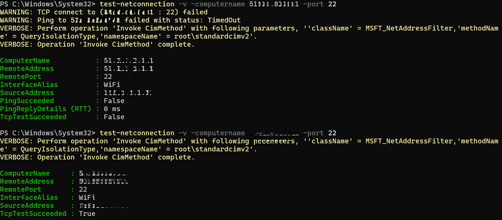
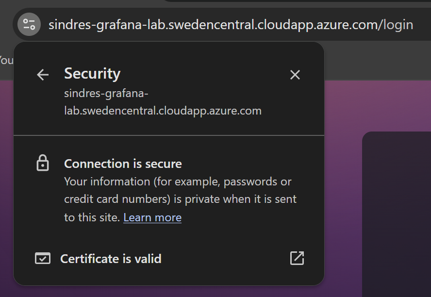
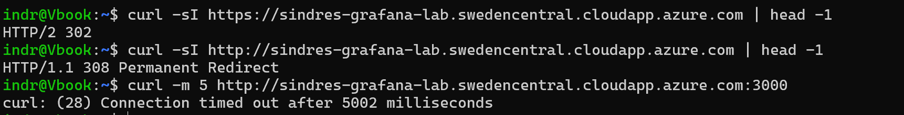
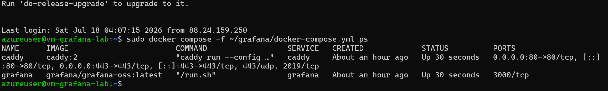
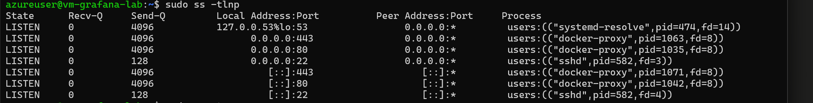
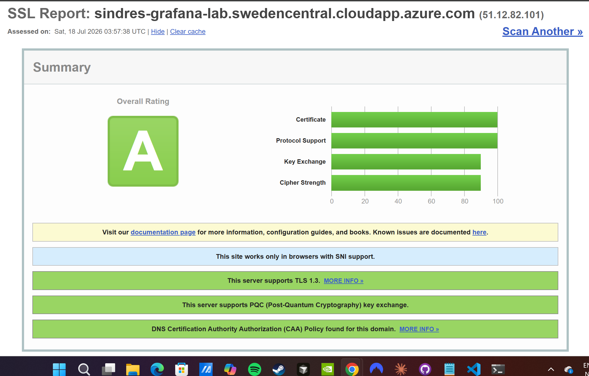

# 01 - Infrastructure: Grafana with HTTPS on an Azure VM

**Goal:** Grafana OSS running in Docker behind Caddy, serving valid HTTPS at `https://<OUR_GRAFANA_FQDN>`, with local admin login working.

**Why this matters for the IAM phases:** Entra requires HTTPS redirect URIs (except localhost), and the provisioning service requires a publicly reachable SCIM endpoint with a trusted certificate. Everything downstream depends on this base being solid.

> This document describes the clean path. The detours actually taken while building it (SKU restrictions, an NSG misconfiguration) are recorded in the [lab journal](90-lab-journal.md) and [troubleshooting log](99-troubleshooting.md).

## 1. Deploy the VM

Create a VM with the following settings; everything not listed keeps its default.

**Basics**

| Setting | Value | Why |
|---|---|---|
| Resource group | `rg-grafana-iam-lab` (new) | Single blast radius; delete the RG to tear down the whole lab |
| VM name | `vm-grafana-lab` | |
| Region | Sweden Central (any region with capacity works) | VM size availability is per-subscription, per-region - check before committing, since the region becomes part of the FQDN |
| Image | **Ubuntu Server 22.04 LTS – x64 Gen2** | Free (no license fee); x64 must match the VM size architecture; Gen2 = modern UEFI boot |
| Size | `Standard_B2als_v2` (2 vCPU / 4 GiB, burstable) | Cheapest current-generation size that comfortably runs Grafana + Caddy + later the SCIM gateway (~$30/month, less when deallocated) |
| Authentication | **SSH public key** → use existing key, paste contents of `~/.ssh/id_ed25519.pub` | Key-only auth; the private key never leaves the workstation. Password auth stays disabled |
| Inbound ports | **None** | Start closed; every open port is added as an explicit rule below |

**Disks:** Standard SSD (Premium unnecessary at lab scale).

**After creation**

1. **DNS label:** Public IP resource → Configuration → DNS name label = `<DNS_LABEL>`. This yields the stable FQDN `<DNS_LABEL>.<REGION>.cloudapp.azure.com`. The FQDN gets baked into the Entra redirect URI, Grafana's `root_url`, and the SCIM tenant URL - treat it as immutable from here on. The Standard-SKU public IP is static, so name and address survive restarts.
2. **NSG inbound rules** (VM → Networking):

| Rule | Priority | Source | Src ports | Dest ports | Purpose |
|---|---|---|---|---|---|
| Allow-SSH-Admin | 1000 | IP addresses: `<Admin_IP>` | `*` | 22 | Management, admin workstation only |
| Allow-HTTPS | 1010 | Any | `*` | 443 | Users + Entra provisioning service |
| Allow-HTTP-ACME | 1020 | Any | `*` | 80 | Let's Encrypt HTTP-01 challenge only; Caddy redirects everything else to HTTPS |

> **HTTP and HTTPS source ports are always `*`.** Clients connect *from* random ephemeral ports *to* the service port. Setting a source port silently breaks the rule. It looks correct in the portal and matches nothing. Verified the hard way; see the troubleshooting log. `az network nic list-effective-nsg` shows the merged rules actually in force, which is the ground truth when portal and reality disagree.


*Same rule, before/after: with a source port specified the connection times out; with source `*` it connects.*

Destination is left as as the VMs private IP, the NSG is attached to a single NIC/subnet. Application Security Groups would be the multi-VM production pattern. Outbound stays at Azure defaults (allow all) - the VM legitimately needs 443/80 out for the OIDC token exchange, ACME, and package pulls; restricting egress is production hardening with no teaching value here.

Grafana's own port 3000 is never opened. TLS terminates at Caddy and Grafana is reachable only on the Docker network.

## 2. Install Docker (production repository method)

```bash
ssh azureuser@<GRAFANA_FQDN>

sudo install -m 0755 -d /etc/apt/keyrings
sudo curl -fsSL https://download.docker.com/linux/ubuntu/gpg -o /etc/apt/keyrings/docker.asc
echo "deb [arch=$(dpkg --print-architecture) signed-by=/etc/apt/keyrings/docker.asc] \
  https://download.docker.com/linux/ubuntu $(. /etc/os-release && echo $VERSION_CODENAME) stable" | \
  sudo tee /etc/apt/sources.list.d/docker.list
sudo apt-get update
sudo apt-get install -y docker-ce docker-ce-cli containerd.io docker-buildx-plugin docker-compose-plugin
sudo docker version
```

Two deliberate choices over the common quick path:

- **Repository install instead of `curl | sh`** - packages are GPG-verified and version-pinnable; piping a script from the internet into a root shell is neither.
- **No `docker` group membership** - membership is root-equivalent (`docker run -v /:/host ...`). All Docker commands run via `sudo`, keeping each invocation explicit and logged. Production goes further: humans don't touch the daemon at all; CI/CD or an orchestrator does.

## 3. Deploy Grafana + Caddy

Copy the `grafana/` directory from the repo to the VM and configure:

```bash
# from the workstation (WSL)
scp -r ./grafana azureuser@<GRAFANA_FQDN>:~/grafana
ssh azureuser@<GRAFANA_FQDN>

cd ~/grafana
sed -i 's/\r$//' Caddyfile docker-compose.yml .env.example   # strip Windows CRLF line endings
cp .env.example .env
nano .env          # set GRAFANA_DOMAIN=<GRAFANA_FQDN> and GRAFANA_ADMIN_PASSWORD
chmod 600 .env     # owner-only: this file holds secrets

sudo docker compose config | grep GF_        # preview the rendered config before applying
sudo docker compose up -d
```

What happens on first start:

- **Caddy** solves the ACME HTTP-01 challenge, obtains a Let's Encrypt certificate for `GRAFANA_DOMAIN`, and auto-renews it. No certificate files are ever handled manually.
- **Grafana** starts with `GF_SERVER_ROOT_URL=https://<GRAFANA_FQDN>`. This must match the public URL exactly - Grafana derives the OIDC redirect from it, and a mismatch is the most common SSO failure (`AADSTS50011`).
- Grafana takes ~30 s to become ready; Caddy answers first, so very early requests can return 502. Transient.

**Observation worth recording:** within seconds of certificate issuance, automated scanners begin probing the new hostname (`/.env`, `/wp-config.php`, `/backup.sql`, `/.git/HEAD`, the Grafana API). New certificates are published in public Certificate Transparency logs, and bots watch the feed. Every public HTTPS endpoint is discovered the moment it exists, the concrete argument for deny-by-default assignment and disciplined secret handling in the identity phases.


*First visit over HTTPS: Caddy obtained and is serving a valid Let's Encrypt certificate.*

## 4. Verify

Positive tests (it works):

| Check | Command / action | Expected |
|---|---|---|
| Containers healthy | `sudo docker compose ps` | both `running` |
| TLS valid | browser → `https://<GRAFANA_FQDN>` | Grafana login page, padlock, Let's Encrypt cert |
| Local login | `admin` / `<GRAFANA_ADMIN_PASSWORD>` | Grafana home |
| Reboot survival | `sudo reboot`, wait, re-check | containers auto-start (`restart: unless-stopped`), cert persists (volume), no re-issuance |

Negative tests (it's closed):

| Check | Command | Expected |
|---|---|---|
| HTTP redirects | `curl -sI http://<GRAFANA_FQDN> \| head -1` | `308` → HTTPS |
| 3000 unreachable | `curl -m 5 http://<GRAFANA_FQDN>:3000` | timeout |
| SSH restricted | `nc -zvw5 <GRAFANA_FQDN> 22` from an allowed vs. other network | succeeds only from `<MY_IP>` |
| Listening surface | `sudo ss -tlnp` on the VM | 22 (sshd), 80/443 (docker-proxy) - nothing else |


*Browser-validated chain: Let's Encrypt certificate for exactly this hostname.*


*One image, three claims: HTTPS answers, HTTP redirects (308), direct port 3000 times out.*


*Containers created earlier, up seconds after an unattended reboot - `restart: unless-stopped` + persistent volumes.*


*Attack surface after: sshd on 22, docker-proxy on 80/443 - Grafana's 3000 absent from public interfaces.*

Optional: SSL Labs scan (expect A), `sudo docker exec grafana grafana server -v` against the current release.


*External validation of the TLS configuration (Qualys SSL Labs).*

## Security posture at end of Phase 1

- TLS-only, auto-renewed certificates; HTTP redirects.
- SSH key-only, source-IP restricted; password auth disabled.
- Deny-all NSG baseline with three explicit, documented inbound rules.
- Single ingress via Caddy; Grafana unreachable directly.
- Local `admin` account active. Acceptable now; becomes the documented break-glass path once SSO is live (Phase 2).
