# 02 - SSO: Entra ID OIDC with group-to-role mapping

**Goal:** test users sign in to Grafana with their Entra accounts; their Grafana role (Admin / Editor / Viewer) is derived from Entra group membership via app roles; unassigned users are rejected at the identity provider.

Reference model: [00-architecture.md §4–5](00-architecture.md#4-entra-object-model-app-registration-vs-enterprise-application).

## 1. Create test users and groups

Three employees, one per Grafana role, plus one group per role:

| User | UPN | Group | Persona |
|---|---|---|---|
| Amanda Admin | `amanda.admin@<TENANT_DOMAIN>` | `grafana-admins` | Platform engineer - runs the Grafana service |
| Edvard Editor | `edvard.editor@<TENANT_DOMAIN>` | `grafana-editors` | SRE/analyst - builds dashboards |
| Victoria Viewer | `victoria.viewer@<TENANT_DOMAIN>` | `grafana-viewers` | Stakeholder - read-only consumer |

Created with a short az CLI script, which is not kept in the repo: it is throwaway lab convenience, and the
production answer is HR-driven provisioning rather than a script (see the production note below). What is
kept is the verification, because that is the part worth reusing. Verification runs on Microsoft Graph
PowerShell, which proved more reliable than az's `.cmd` wrapper for directory queries on Windows (quoting
issues, see the [troubleshooting log](99-troubleshooting.md)):

```powershell
Connect-MgGraph -Scopes "User.ReadWrite.All","Group.ReadWrite.All"

Get-MgGroup -Filter "startswith(displayName,'grafana')" | Select-Object DisplayName, Id

foreach ($g in "grafana-admins","grafana-editors","grafana-viewers") {
  $grp = Get-MgGroup -Filter "displayName eq '$g'"
  $members = Get-MgGroupMember -GroupId $grp.Id | ForEach-Object { $_.AdditionalProperties.displayName }
  Write-Host "$g : $members"
}
```

> **Why groups, not direct user assignment:** membership becomes the single control point for both role (this phase) and account lifecycle (Phase 3). Note that users must be **direct** members. Microsoft lists nested groups as unsupported for app role assignment, "for both access and provisioning" ([Entra service limits](https://learn.microsoft.com/entra/identity/users/directory-service-limits-restrictions)), so this constrains Phase 3's provisioning scope as well.

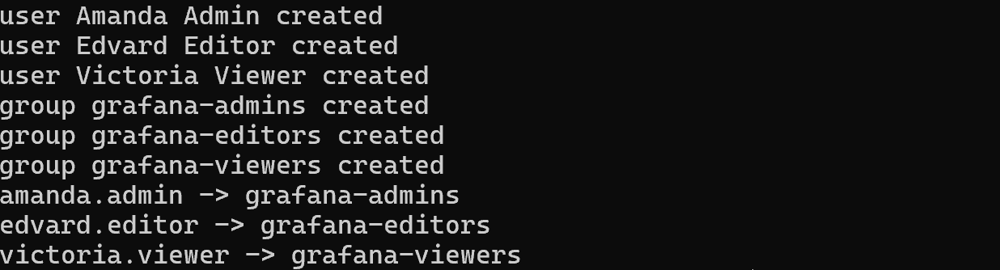
*Script output: three users, three groups, three memberships.*

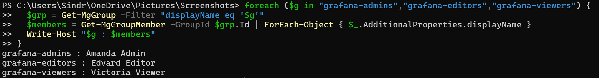
*Graph PowerShell verification - every write confirmed by a read.*

> **Production note:** in a real tenant, users are not script-created - they arrive via HR-driven provisioning (lifecycle workflows / directory sync), each with a unique credential or Temporary Access Pass. The script pattern here is lab convenience; the group-based access model is the part that transfers.

## 2. Register the application

**Entra admin center → App registrations → New registration**

| Field | Value |
|---|---|
| Name | `app-grafana-lab` |
| Supported account types | Accounts in this organizational directory only (single tenant) |
| Redirect URI | Platform **Web**, `https://<GRAFANA_FQDN>/login/azuread` |

After creation, note **Application (client) ID** → `<CLIENT_ID>` and **Directory (tenant) ID** → `<TENANT_ID>`.

Then, under **Certificates & secrets → New client secret**: description `grafana-oidc`, expiry 6 months. Copy the **value** immediately (shown once) → goes into `.env` on the VM as `AZUREAD_CLIENT_SECRET`, nowhere else.

> **Why a client secret:** Grafana is a *confidential client* - server-side code that can keep a secret, unlike an SPA. PKCE is still enabled on top (defense in depth against code interception). Production upgrade path: certificate credential or federated credential instead of a shared secret.

📸 *Evidence gap, not yet captured: registration overview page (IDs visible are fine - they are identifiers, not secrets) and the redirect URI config.*

## 3. Define app roles

**App registration → App roles → Create app role**, three times:

| Display name | Allowed member types | Value | Description |
|---|---|---|---|
| Grafana Admin | Users/Groups | `Admin` | Grafana org admin |
| Grafana Editor | Users/Groups | `Editor` | Can edit dashboards |
| Grafana Viewer | Users/Groups | `Viewer` | Read-only |

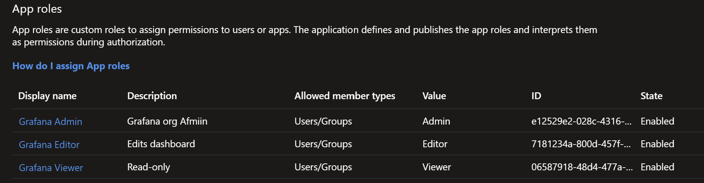
*Three app roles; the Value column is the contract - it lands verbatim in the token's `roles` claim.*

The **Value** strings must match Grafana's role names exactly - they arrive verbatim in the token's `roles` claim and Grafana matches them case-sensitively. (Optional fourth role `GrafanaAdmin` grants *server* admin, distinct from org admin; enabled by `allow_assign_grafana_admin` on the Grafana side.)

## 4. Configure the enterprise application

**Entra admin center → Enterprise applications → app-grafana-lab**

1. **Properties → Assignment required = Yes.** Without this, any tenant user can authenticate; with it, unassigned users are stopped at Entra with `AADSTS50105`, which Microsoft documents as meaning the user is neither directly assigned nor a direct member of an assigned group ([Microsoft Learn](https://learn.microsoft.com/troubleshoot/entra/entra-id/app-integration/error-code-aadsts50105-user-not-assigned-role)). This is the app-level authorization gate, enforced *before* any token is issued.
2. **Users and groups → Add user/group**, three assignments:

| Group | Role |
|---|---|
| `grafana-admins` | Grafana Admin |
| `grafana-editors` | Grafana Editor |
| `grafana-viewers` | Grafana Viewer |

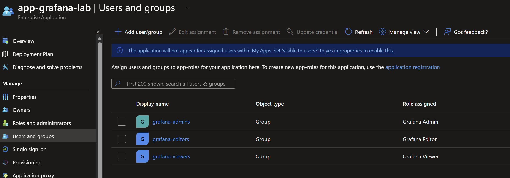
*The authorization model in one screen: each group mapped to its app role on the service principal.*

The portal shows group-to-role assignments but not the effective user-to-role mapping, which is what actually
matters when someone asks "who is a Grafana admin?". [`scripts/UserGroupRole-Relation.ps1`](../scripts/UserGroupRole-Relation.ps1)
answers that: it reads the app role assignments off the service principal and expands group members through them.
Run it after any assignment change.

Also on **Properties**: **Visible to users = Yes** (My Apps tile - discoverability only, grants no access), and set the app registration's **Branding → Home page URL** to `https://<GRAFANA_FQDN>` so the tile opens the app.

📸 *Evidence gap, not yet captured: Properties page showing Assignment required = Yes.*

## 5. Consent

First SSO sign-in stopped with **"Approval required"**. Expected behavior, worth understanding:

- Grafana requests the delegated OIDC scopes `openid profile email` at runtime (visible in the authorize URL), and the registration carries Entra's default `User.Read`.
- This tenant restricts **user consent** (best practice - it's the control that blunts consent-phishing), so a standard user cannot approve even minimal scopes; an admin must.

Two grant mechanisms, both demonstrated:

```powershell
$sp    = Get-MgServicePrincipal -Filter "displayName eq 'app-grafana-lab'"
$graph = Get-MgServicePrincipal -Filter "appId eq '00000003-0000-0000-c000-000000000000'"

# (a) per-user grant - applies to one principal only (no portal equivalent)
$user = Get-MgUser -UserId amanda.admin@<TENANT_DOMAIN>
New-MgOauth2PermissionGrant -ClientId $sp.Id -ConsentType "Principal" `
  -PrincipalId $user.Id -ResourceId $graph.Id -Scope "openid profile email"

# (b) tenant-wide admin consent - one audited decision for all users
#     (portal: App registration → API permissions → "Grant admin consent")
New-MgOauth2PermissionGrant -ClientId $sp.Id -ConsentType "AllPrincipals" `
  -ResourceId $graph.Id -Scope "openid profile email User.Read"
```

The lab used (a) to prove the granular mechanism, then settled on (b) - per-user grants don't scale. Blast radius of the tenant-wide grant is minimal: read-basic-profile scopes only.

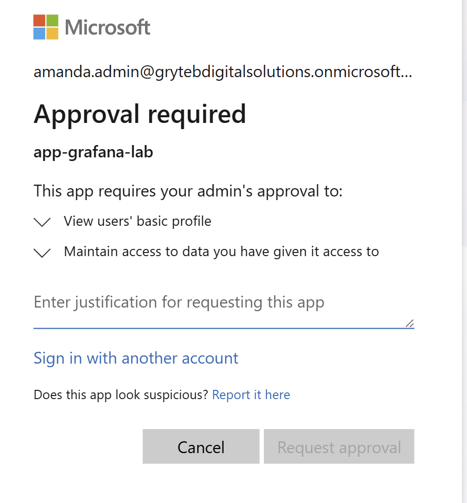
*Restricted user consent working as intended: a standard user cannot approve even minimal scopes.*

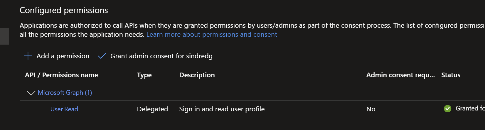
*One audited, tenant-wide decision on the API permissions blade.*

## 6. Configure Grafana

On the VM, extend `.env` (see `.env.example`) with:

```
AZUREAD_SSO_ENABLED=true
AZUREAD_TENANT_ID=<TENANT_ID>
AZUREAD_CLIENT_ID=<CLIENT_ID>
AZUREAD_CLIENT_SECRET=<CLIENT_SECRET>
```

then `docker compose up -d` (recreates Grafana with the azuread provider enabled).

The compose file maps these to Grafana's `[auth.azuread]` settings. The security-relevant choices, with
defaults per the [Grafana Entra ID OAuth documentation](https://grafana.com/docs/grafana/latest/setup-grafana/configure-access/configure-authentication/entraid/):

| Setting | Value | Why |
|---|---|---|
| `role_attribute_strict` | `true` (default `false`) | Users whose token carries no valid `roles` claim are **denied**, not silently defaulted to Viewer. Misconfigurations fail loudly |
| `allowed_organizations` | `<TENANT_ID>` | Rejects tokens from any other tenant - belt-and-braces on top of single-tenant registration. Note the compose default is empty, so an unset `AZUREAD_TENANT_ID` removes this check silently; see the [risk note](risk-and-limitations.md#a-tenant-misconfiguration-fails-open-rather-than-closed) |
| `use_pkce` | `true` | Code interception protection on top of the client secret |
| `allow_sign_up` | `true` | JIT-create the Grafana user on first successful SSO login. Phase 3 adds SCIM pre-provisioning; this stays on alongside it. It cannot create an account for anyone Entra would have refused, since assignment is required and `role_attribute_strict` denies a token with no valid `roles` claim |
| `allow_assign_grafana_admin` | `true` (default `false`) | Permits granting Grafana *server* admin from the token. No `GrafanaAdmin` app role exists, so nothing is grantable today |
| `skip_org_role_sync` | `false` | Re-evaluate the role from the token at every login, so group changes propagate |

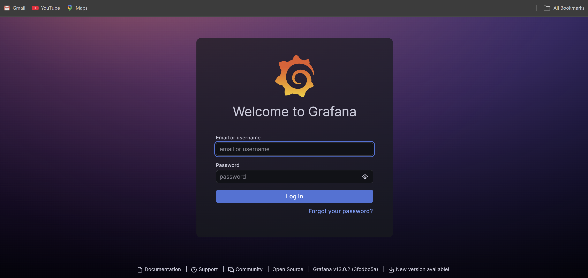
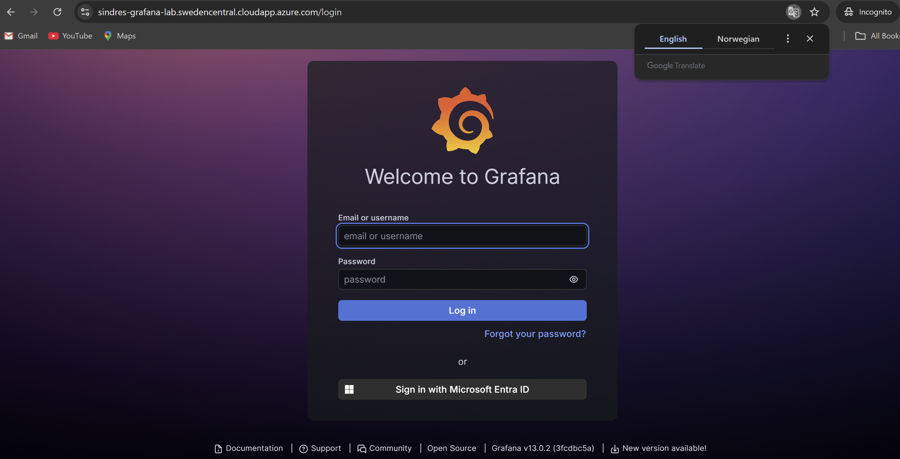
*Before/after applying the SSO configuration: the Entra ID sign-in option appears.*

## 7. Test matrix

| Test | Actor | Expected result |
|---|---|---|
| Admin login | amanda.admin | "Sign in with Microsoft" → Entra sign-in → Grafana, org role **Admin** (Administration menu visible) |
| Editor login | edvard.editor | Role **Editor** - can create dashboards, no admin menu |
| Viewer login | victoria.viewer | Role **Viewer** - read-only |
| Unassigned user | any user in none of the groups | Blocked **at Entra**: `AADSTS50105 – not assigned to a role for the application` |
| Role change | move edvard.editor editors→viewers, re-login | Role drops to Viewer on next sign-in (not mid-session) |

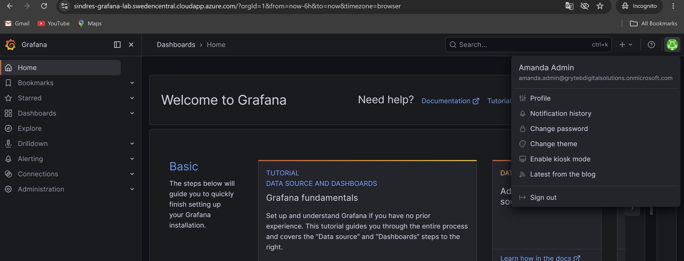
*Amanda in Grafana after Entra sign-in - account JIT-created, role derived from the token. Administration menu visible, so the `Admin` app role landed.*

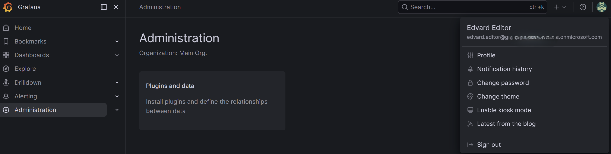
*Edvard, same flow, role **Editor**: dashboard editing available, no Administration menu.*

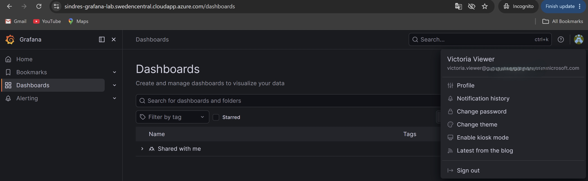
*Victoria, role **Viewer**: read-only. Three personas, three app roles, one membership model.*

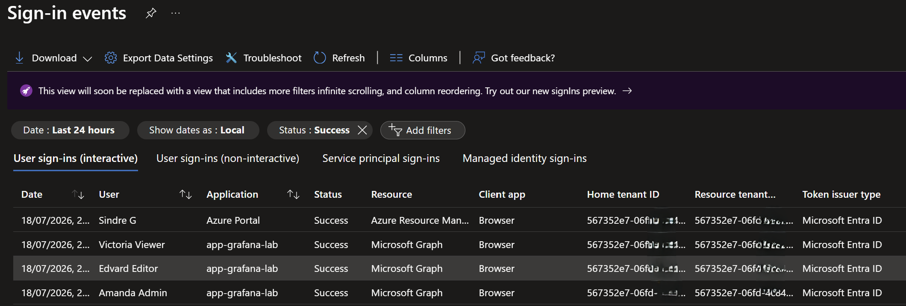
*The other half of the claim: Grafana logins now appear in Entra's sign-in logs, so the application inherits tenant-level audit without Grafana doing anything.*

📸 *Evidence gap, not yet captured: the AADSTS50105 error page for an unassigned user, and the role-change propagation retest (rows 4 and 5). Both were confirmed interactively while building the phase, so treat those two rows as reported rather than shown.*

## 8. Inspect the token (optional but recommended)

To see exactly what Grafana receives: temporarily add `https://jwt.ms` as a second Web redirect URI on the app registration, then open

```
https://login.microsoftonline.com/<TENANT_ID>/oauth2/v2.0/authorize?client_id=<CLIENT_ID>&response_type=id_token&redirect_uri=https%3A%2F%2Fjwt.ms&scope=openid%20profile%20email&nonce=lab&response_mode=fragment
```

sign in as amanda.admin, and read the decoded ID token - confirm `roles: ["Admin"]`, `tid`, `iss`, `aud` against [00-architecture.md §5](00-architecture.md#5-token-flow-and-claims-phase-2). **Remove the jwt.ms redirect URI afterwards** (an idle debugging redirect is unnecessary attack surface).

📸 *Evidence gap, not yet captured: jwt.ms decoded token with the roles claim highlighted (blur `oid`/`sub` if publishing).*

## Security posture at end of Phase 2

- Authentication centralized in Entra: tenant password policy, MFA capability, sign-in logs now cover Grafana.
- Authorization declarative: token-borne app roles, strict mapping, no per-app user administration.
- Access denied by default: assignment required + `role_attribute_strict`.
- Local `admin` retained as documented break-glass only; consider `disable_login_form = true` once SSO is proven stable.

Known limitation, resolved in Phase 3: removing a user's group membership stops *future* logins but does not touch the existing Grafana account or active sessions - SSO is not deprovisioning.
