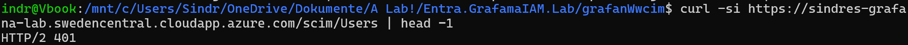
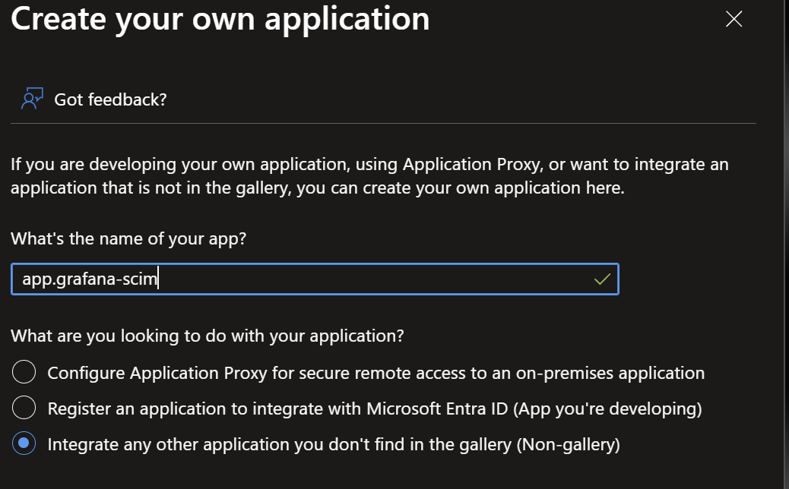
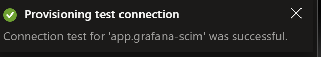
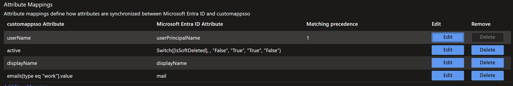
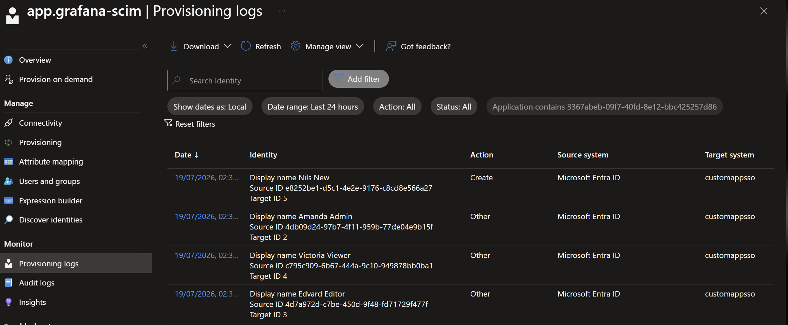
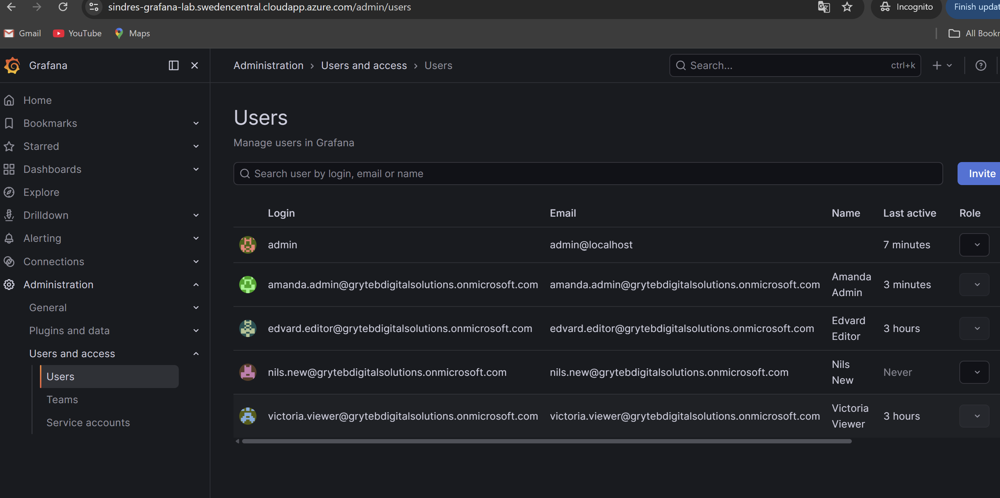
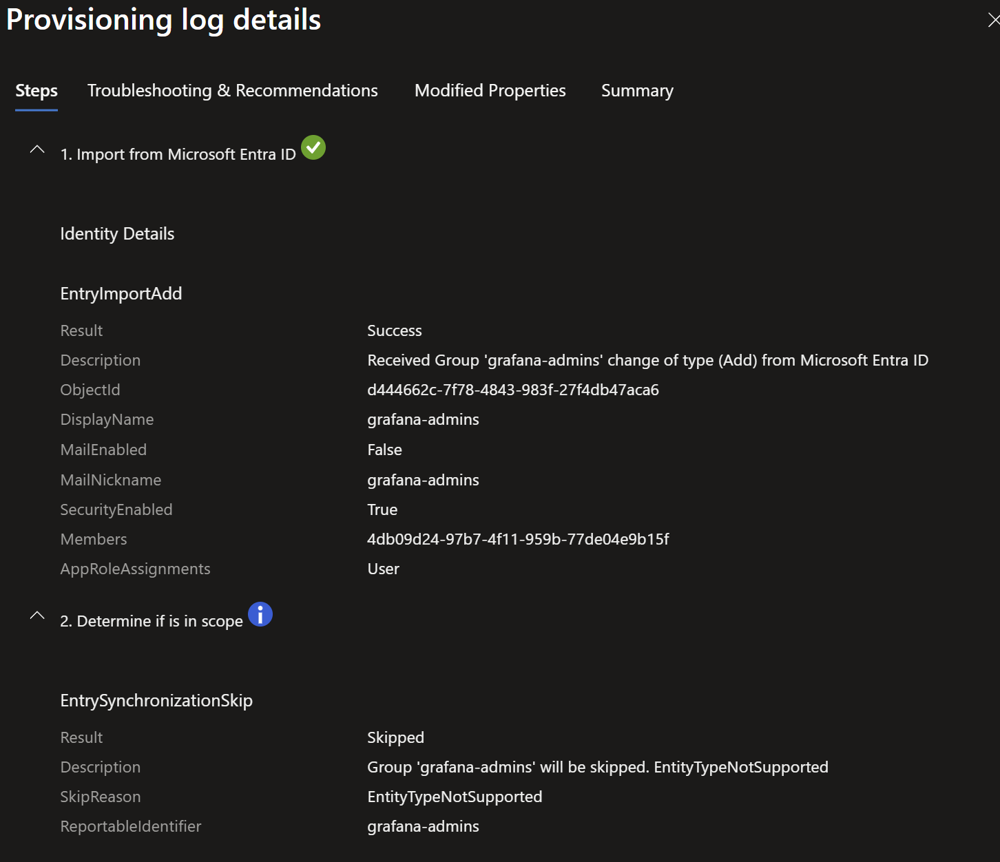
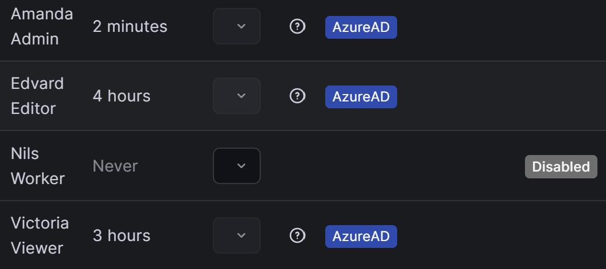
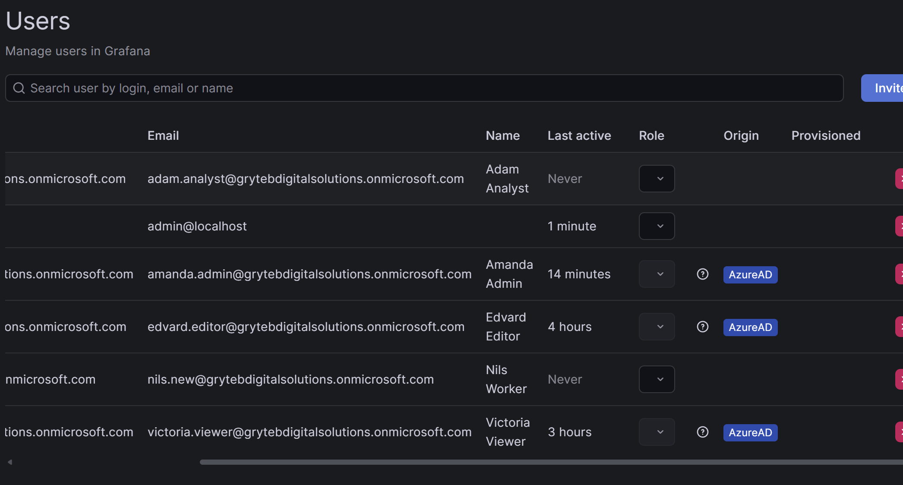
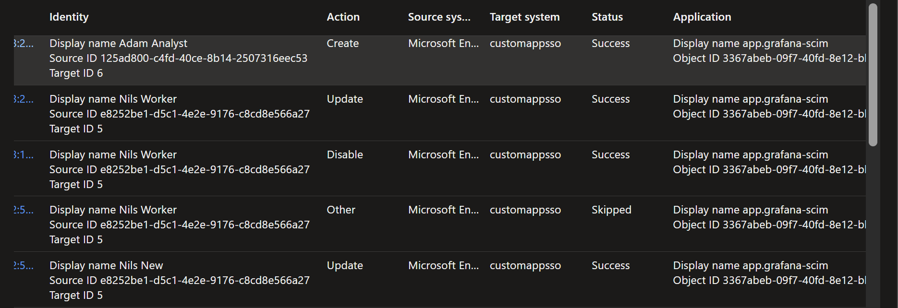

# 03 - SCIM: Entra automatic provisioning

**Goal:** the Entra provisioning service creates, updates, and deprovisions Grafana accounts automatically from group membership - no login required, no orphaned accounts.

*Status: done. Executed as described below, with two deviations worth knowing: provisioning had to be hosted on a second, non-gallery enterprise app (`app-grafana-scim`) because the portal disables custom SCIM provisioning on enterprise apps auto-created from app registrations; and the test roster grew (Nils Worker, Adam Analyst). Full narrative in the [lab journal](90-lab-journal.md).*

## Why SCIM when SSO already works

SSO answers "may this person log in *now*?". It does not:

- create the account before first login (JIT means no account until the user shows up),
- update attributes when they change in the directory,
- **remove or disable the account when access is revoked** - the critical gap. After Phase 2, deleting edvard.editor from the editors group leaves his Grafana account intact forever; it just can't be logged into via SSO. Auditors call that an orphaned account.

*Before-state: `nils.new` has access per Entra (group member, app-assigned) but no account exists in Grafana - nothing happens until first login or SCIM.*

SCIM (System for Cross-domain Identity Management) is the standard REST and JSON protocol for this lifecycle plane, specified in [RFC 7643](https://datatracker.ietf.org/doc/html/rfc7643) (schema) and [RFC 7644](https://datatracker.ietf.org/doc/html/rfc7644) (protocol). Entra's provisioning service is the SCIM *client*; the application exposes the SCIM *server* endpoint. Entra implements a specific profile of SCIM 2.0 rather than the whole standard, which is why the bridge only needs to cover a subset ([Microsoft Learn](https://learn.microsoft.com/entra/identity/app-provisioning/use-scim-to-provision-users-and-groups)).

## The Grafana licensing constraint, and the chosen design

Grafana's native SCIM provisioning is Enterprise and Cloud only, and the same documentation notes it
"only works with SAML authentication" ([Configure SCIM provisioning](https://grafana.com/docs/grafana/latest/setup-grafana/configure-access/configure-scim-provisioning/),
checked July 2026). This lab runs Grafana OSS over OIDC, since SAML is also Enterprise, so **there is
no native SCIM path here at any licence tier.** To exercise the real Entra provisioning engine against
a real SCIM 2.0 endpoint, a small bridge container translates SCIM calls into Grafana admin API calls:

```
Entra provisioning service ──SCIM 2.0/HTTPS──► Caddy /scim/* ──► scim-bridge ──Grafana admin API──► Grafana
```

Everything on the Entra side (provisioning config, attribute mappings, scoping, provisioning logs) is
exactly what it would be against a natively SCIM-capable app. The bridge is the app-side adapter,
equivalent to what Grafana Enterprise ships built-in. The trade-off: production would use the vendor's
native endpoint, and this is a lab substitute we own and must maintain.

Implementation is a purpose-built bridge ([`scim-bridge/app.py`](../scim-bridge/app.py), ~200 lines of
Python/Flask) rather than a gateway framework, since no ready-made Grafana plugin exists for any of
them and a single readable file implementing exactly the SCIM subset Entra uses doubles as protocol
documentation. Reasoning in [ADR 0002](adr/0002-custom-scim-bridge.md). Operation mapping:

| SCIM operation | Grafana admin API |
|---|---|
| `POST /Users` | `POST /api/admin/users` (create with random password - login happens via SSO anyway) |
| `GET /Users?filter=userName eq "..."` | `GET /api/users/lookup?loginOrEmail=...` |
| `PATCH /Users/{id}` set `active=false` | `POST /api/admin/users/{id}/disable` |
| `PATCH /Users/{id}` set `active=true` | `POST /api/admin/users/{id}/enable` |
| `DELETE /Users/{id}` | `POST /api/admin/users/{id}/disable` (see below) |

**`DELETE` is deliberately not a delete.** Entra's documented default for an unassigned, out-of-scope or
blocked user is a soft delete via `PATCH active=false`; `DELETE` is reserved mainly for a user
*permanently* removed from the directory, either 30 days after a soft delete or on a manual permanent
delete ([Microsoft Learn](https://learn.microsoft.com/entra/identity/app-provisioning/how-provisioning-works#deprovisioning)).
The bridge maps it to the same disable, so no lifecycle event this endpoint receives can destroy a
Grafana account or its audit trail. That departs from a literal reading of RFC 7644 and means a disabled
account can outlive the Entra identity it came from ([ADR 0001](adr/0001-soft-delete-over-hard-delete.md)).

**The bridge never sets an org role.** Authorization arrives in the `roles` claim at SSO time, so a user
provisioned by SCIM who has not yet logged in exists in Grafana at the default org role rather than the
role their group implies. Correct on the lifecycle axis, not yet on the authorization axis: "provisioned"
and "authorized" are two different moments.

**Bridge security.** Listens only on the Docker network, Caddy routes only `/scim/*` to it, and every
request must carry `Authorization: Bearer <SCIM_SECRET_TOKEN>`, checked in constant time before any
route runs. Its Grafana admin credential lives in `.env`. Since the bridge holds a full Grafana admin
credential, that bearer token is the only thing between the internet and account administration, which
is why it is a generated 32-byte value and why burning one during the lab meant regenerating rather
than reusing it.

## Build steps

### 1. Deploy the bridge

- Add the `scim-bridge` service to `docker-compose.yml`, built from `../scim-bridge`, with `<SCIM_SECRET_TOKEN>` and the Grafana admin credentials from `.env`. No published ports: it is reachable only through Caddy.
- Add to `Caddyfile`: `handle_path /scim/* { reverse_proxy scim-bridge:8080 }`. `handle_path` strips the prefix, so the bridge sees `/Users` and `/ServiceProviderConfig`.
- Bring it up with `sudo docker compose up -d --build`.
- Smoke-test: `curl -H "Authorization: Bearer <SCIM_SECRET_TOKEN>" https://<GRAFANA_FQDN>/scim/Users` → SCIM `ListResponse`.


*Negative smoke test: no bearer token, no entry. (First attempt returned Grafana's 302 instead - Caddy needed a restart to load the new route; see troubleshooting log.)*

### 2. Configure Entra provisioning

**Enterprise applications → app-grafana-lab → Provisioning**:

| Setting | Value |
|---|---|
| Mode | Automatic |
| Tenant URL | `https://<GRAFANA_FQDN>/scim` |
| Secret token | `<SCIM_SECRET_TOKEN>` |

**Test Connection** must pass (Entra sends an authenticated `GET /Users` probe).

> **As built:** provisioning could not be enabled on `app-grafana-lab`, because enterprise apps auto-created from app registrations do not support custom SCIM provisioning in the portal. A second, provisioning-only non-gallery app `app-grafana-scim` hosts the provisioning engine with the same three groups assigned, where assignment defines *scope* and no roles are involved. SSO and provisioning now live on separate service principals whose assignment lists must be kept aligned by hand, which is the most significant residual risk the lab carries. See [ADR 0003](adr/0003-separate-provisioning-service-principal.md) and the [risk note](risk-and-limitations.md).


*Non-gallery enterprise app dedicated to provisioning.*


*Entra's authenticated probe to the bridge succeeded - credentials and endpoint validated.*

### 3. Attribute mappings

Trim the default user mapping to what Grafana needs:

| Entra attribute | SCIM attribute | Grafana field |
|---|---|---|
| `userPrincipalName` | `userName` | login |
| `displayName` | `displayName` | name |
| `mail` (fallback UPN) | `emails[type eq "work"].value` | email |
| `Switch([IsSoftDeleted],, "False","True","True","False")` | `active` | enabled/disabled |

The `active` mapping is where deprovisioning semantics live: disabled-in-Entra or removed-from-scope → `active=false` → Grafana account disabled (soft delete; audit trail preserved).


*Four mappings only; `userName` is the matching attribute (precedence 1).*

### 4. Scope and start

- **Settings → Scope = Sync only assigned users and groups** - the same three `grafana-*` groups from Phase 2 now drive account lifecycle too.
- Start provisioning; initial cycle, then incremental cycles at approximately 40 minute intervals. The interval is fixed and not configurable ([Microsoft Learn](https://learn.microsoft.com/entra/identity/app-provisioning/known-issues)), so plan revocation timing around it rather than expecting it to be tunable.

### 5. Test matrix

| Test | Action | Expected (within one cycle) |
|---|---|---|
| Create | add new user `nils.new` to `grafana-viewers` | Grafana account exists **before nils.new ever logs in** |
| Update | change nils.new's `displayName` in Entra | name updated in Grafana |
| Deprovision (scope) | remove nils.new from the group | Grafana account **disabled** |
| Deprovision (account) | block sign-in on victoria.viewer's Entra account | Grafana account disabled |
| On-demand | use **Provision on demand** for a single user | immediate result + step-by-step trace, no 40-min wait |
| Audit | Provisioning logs | each operation with source/target correlation |


*Initial cycle: three existing accounts matched ("Other"), Nils created.*


*The core claim of SCIM: account exists in Grafana, last login "never".*


*Groups imported only to expand membership for scoping, then skipped (`EntityTypeNotSupported`) - scope, not payload.*


*Deprovisioning trigger 1: out of scope → `active=false` → disabled in Grafana, no human involved.*


*Re-added to the group → same account re-enabled (no duplicate); new hire Adam Analyst provisioned the same way.*


*The joiner/mover/leaver story in one log view: create, update, disable, enable.*

## Security posture at end of Phase 3

- Joiner/mover/leaver lifecycle automated from directory group membership - the leaver case no longer depends on anyone remembering Grafana exists.
- Account state converges even for users who never log in.
- SCIM endpoint: HTTPS-only, bearer-token-authenticated, path-scoped at the proxy, bridge unreachable from the internet except via `/scim/*`.

What this phase does not close is in the [risk and limitations note](risk-and-limitations.md). The two
that matter: the assignment lists on the SSO app and the provisioning app can drift with nothing to
detect it, reopening the orphaned-account gap through a side door; and a static bearer token with no
rotation guards an endpoint that holds a Grafana admin credential.
